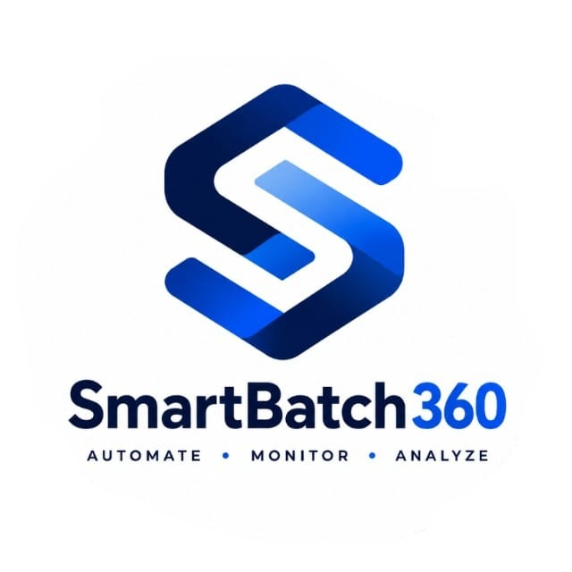
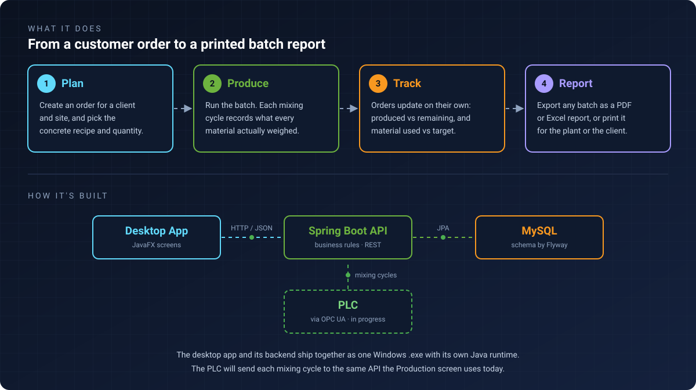
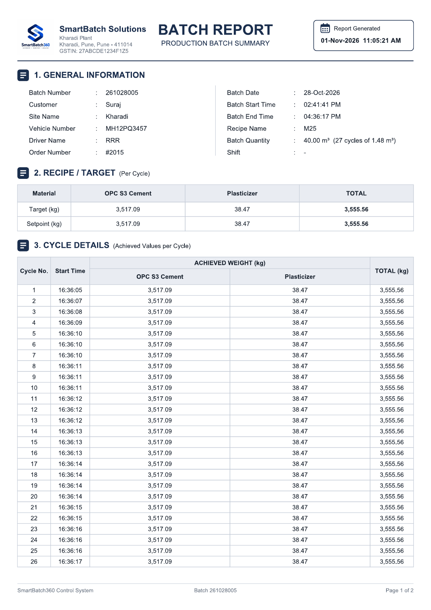
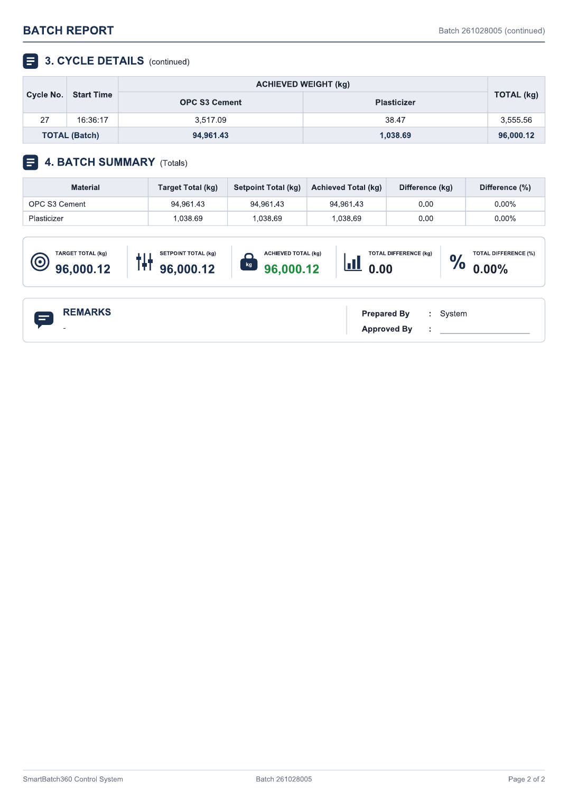

<p align="center">
  
</p>

<p align="center">
  <b>Concrete batching plant management system: a Windows desktop app for production, recipes, orders and batch reports.</b>
</p>

<p align="center">
  
  
  
  
  
  
  
  
</p>

> 🔒 **The source code is private.** SmartBatch360 was built for my college's Electrical Engineering department, which uses it in their lab, so this repository shows what the app does and how it is built, without the code. I'm happy to walk through the code and design in an interview.

---

## 📖 About

SmartBatch360 manages the day-to-day work of a **concrete batching plant**: which recipe is being mixed, for which client and site, in which vehicle, and how much of each material was actually used.

It was built for my college's **Electrical Engineering department lab**, where students use it to run and monitor a batching setup controlled by a **PLC**. Direct PLC integration through an **OPC UA** server is in progress. The app is designed so the PLC can feed production data straight in: today each mixing cycle is entered on the Production screen through the same API endpoint the PLC will use, so connecting the hardware does not require changing the rest of the system.

## ⚙️ How It Works

<p align="center">
  
</p>

## 📄 Sample Batch Report

Every batch can be exported as a **PDF** (or Excel) report, or printed. The report shows the batch details (customer, site, vehicle, driver, order and recipe), the target weight of each material per cycle, what was actually weighed in every mixing cycle, and a final summary of target vs achieved with the difference.

| Page 1: batch details, recipe target and cycle-by-cycle weights | Page 2: batch totals and summary |
|:---:|:---:|
| <a href="docs/sample-batch-report.pdf"></a> | <a href="docs/sample-batch-report.pdf"></a> |

<p align="center"><a href="docs/sample-batch-report.pdf"><b>📥 Open the full sample report (PDF)</b></a></p>

## ✨ Features

- **Dashboard:** live production KPIs and backend, database and plant status, refreshed automatically.
- **Production:** runs one batch at a time; the operator picks the order, recipe and driver, then records each mixing cycle. The last planned cycle completes the batch.
- **Recipes and materials:** recipes built as line items of materials in kilograms, with a running total.
- **Orders:** full lifecycle (Unfulfilled → In Progress → Fulfilled, or Cancelled), with produced vs remaining quantity measured from the batches recorded against each order.
- **Batch Reports:** search and filter by batch number, date range, client, site, vehicle, driver or recipe; export to **PDF** or **Excel**, or print. A single-batch report includes the per-cycle material breakdown.
- **Material Consumption:** target vs achieved vs variance per material, by day, week or month, with a chart.
- **Master data:** Clients, Sites, Vehicles, Drivers, and report Headers (company letterhead), each with search and safe-delete rules.
- **One-click install:** a single `.exe` that bundles its own Java runtime and embedded backend. It creates its own database and tables on first connect.

## 🏗️ Architecture Notes

- The **JavaFX UI talks to the backend only over REST**, never to the database directly, so the backend can also run as a standalone server for multi-PC setups.
- For a simple install, the Spring Boot backend runs **embedded in the same process** as the UI, so users get one app instead of two.
- **DTOs are kept separate from JPA entities**, business validation lives in the backend (not only in the UI), and every schema change is a **Flyway migration**.
- API calls run off the JavaFX UI thread so the window never freezes.
- Timestamps are stored in UTC and converted to the plant's time zone in one place, so night-shift batches land on the correct report date.

## 🛠️ Tech Stack

| Layer | Technology |
|---|---|
| Desktop UI | Java 21, JavaFX 21, Java HttpClient, Jackson |
| Backend | Spring Boot 3, Spring Web, Spring Data JPA, Hibernate, Bean Validation, Actuator |
| Database | MySQL, Flyway migrations (H2 for tests) |
| Reports | Apache PDFBox (PDF and printing), fastexcel (Excel) |
| Build and packaging | Maven multi-module, jpackage (Windows `.exe` with bundled runtime) |
| Testing | JUnit 5, AssertJ, Spring Boot Test |

## 🚀 Installation (for the lab)

- Delivered as a **single Windows `.exe`** that bundles its own Java runtime and the embedded backend, so the lab PC only needs MySQL.
- On first launch, the operator enters the MySQL connection once under **Settings → Database Connection**. The app then creates its own database and tables automatically.
- Each release is packaged with a PowerShell script (Maven build + `jpackage`); the current version is **V8**.

## 📁 Project Structure (private repository)

```
smart_batch_360/
├── backend/   Spring Boot REST API: controllers, services, repositories, Flyway migrations
├── desktop/   JavaFX application: screens, navigation, API client, PDF/Excel export
├── docs/      Requirements, architecture, database, UI and roadmap documents
└── scripts/   Packaging scripts and setup guide
```

## 🗺️ Roadmap

- [x] Master data, recipes, orders, production, batch reports, material consumption
- [x] PDF, Excel and print export
- [x] Single-file Windows installer (V8)
- [ ] Direct PLC integration via OPC UA for automatic cycle capture (in progress)
- [ ] Analytics and alarm/event history

## 👤 Author

**Suraj Vishnu Dombale**: [Portfolio](https://surajdombale.github.io/profile/) · [LinkedIn](https://www.linkedin.com/in/suraj-dombale/) · [GitHub](https://github.com/surajdombale)

Built with AI-assisted development (Claude).
